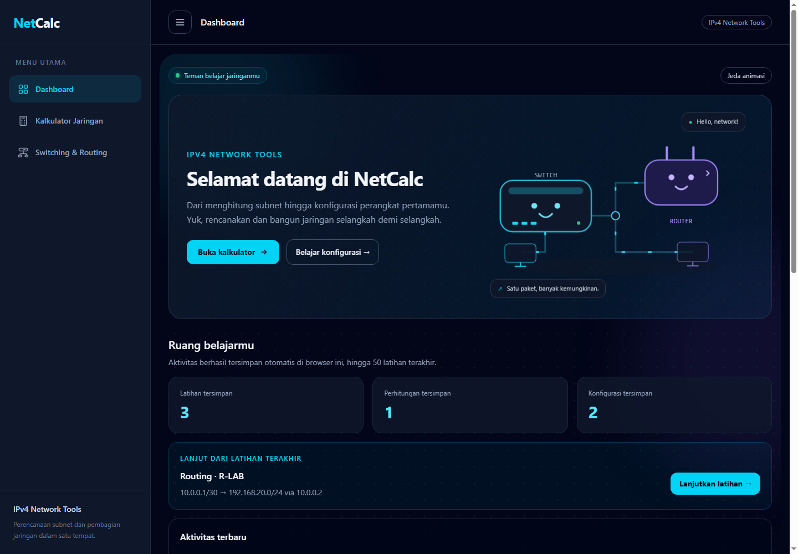
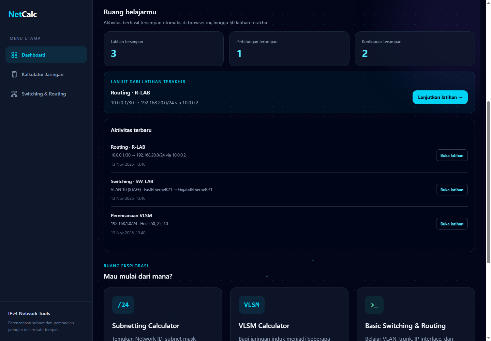
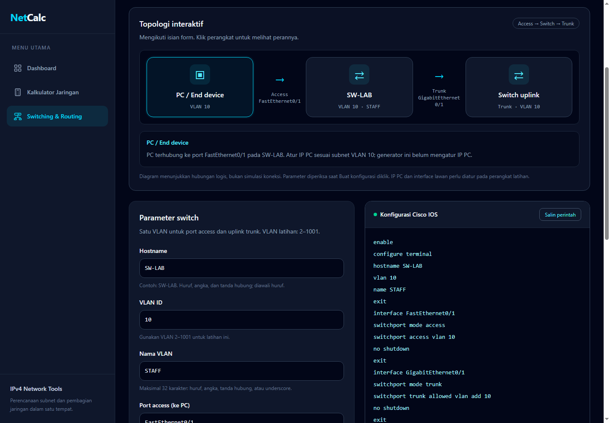
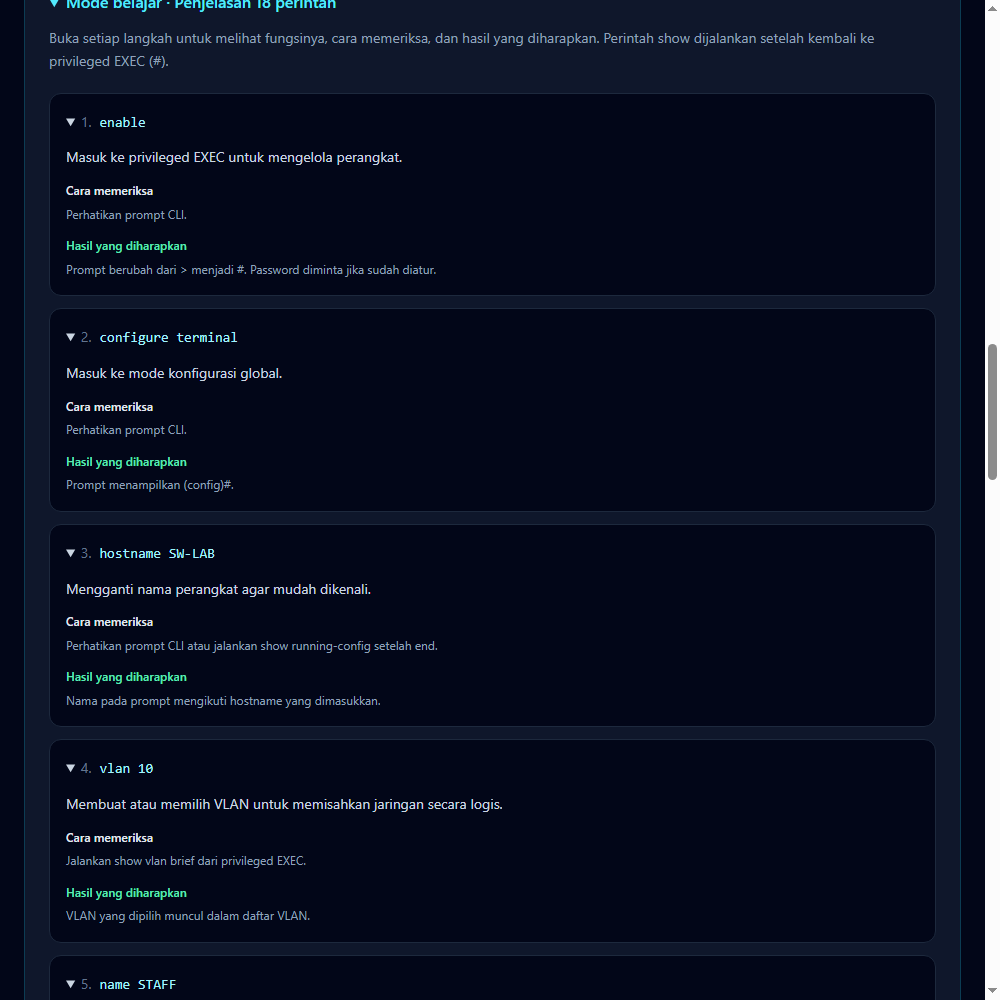

# NetCalc

NetCalc adalah aplikasi belajar jaringan berbasis Laravel untuk menghitung subnet IPv4, merencanakan VLSM, dan membuat konfigurasi dasar Cisco IOS. Aplikasi dilengkapi mode belajar per perintah, topologi interaktif, dan dashboard aktivitas lokal.

## Fitur

- **Subnetting IPv4:** Network ID, broadcast, subnet mask, wildcard mask, rentang IP valid, dan kapasitas host. Mendukung prefix `/0`–`/32`, termasuk perlakuan khusus `/31` dan `/32`.
- **VLSM:** membagi jaringan induk berdasarkan kebutuhan host, mengalokasikan kebutuhan terbesar terlebih dahulu, dan menampilkan tabel subnet. Menggunakan subnet LAN konvensional, minimum `/30`, maksimal 100 kebutuhan subnet.
- **Basic switching:** hostname, VLAN latihan 2–1001, port access, trunk, dan perintah penyimpanan konfigurasi.
- **Basic routing:** IP interface, subnet mask, next hop, serta static route, default route, dan host route. Prefix interface latihan dibatasi 1–30.
- **Mode belajar:** penjelasan setiap perintah, cara memeriksa, dan hasil yang diharapkan.
- **Topologi interaktif:** mengikuti input hostname, port, VLAN, IP, dan jaringan tujuan. Klik perangkat untuk melihat perannya.
- **Dashboard aktivitas:** menyimpan hingga 50 latihan terakhir di browser, menampilkan lima aktivitas terbaru, serta membuka kembali input dan hasil melalui **Lanjutkan latihan**. Input yang sama memperbarui aktivitas sebelumnya.
- **Tampilan responsif:** sidebar dengan hamburger, background bergerak, animasi perangkat, tombol jeda animasi, dan dukungan preferensi reduced motion.

## Tampilan

Screenshot menggunakan data contoh latihan, bukan hasil pengujian perangkat jaringan langsung.

### Dashboard



<details>
<summary>Aktivitas, topologi, dan mode belajar</summary>







</details>

## Teknologi dan kebutuhan

| Komponen | Kebutuhan |
| --- | --- |
| PHP | 8.4.1 atau lebih baru, mengikuti dependency yang terkunci di `composer.lock` |
| Composer | 2.2 atau lebih baru |
| Node.js | 22.12 atau lebih baru |
| Backend | Laravel 12 |
| Frontend | Blade, Tailwind CSS 4, JavaScript, Vite 7 |
| Database bawaan | SQLite |
| Ekstensi PHP | PDO SQLite, OpenSSL, fileinfo, DOM/XML; mbstring disarankan |

PHP bawaan XAMPP dapat digunakan jika versinya memenuhi persyaratan. MySQL XAMPP tidak diperlukan untuk konfigurasi bawaan ini.

## Instalasi lokal

Clone repository ini menggunakan URL pada tombol **Code** di GitHub, lalu buka folder proyek. Contoh perintah clone:

```bash
git clone <URL_REPOSITORY> netcalc
cd netcalc
```

Untuk checkout baru, jalankan:

```bash
composer install
php -r "file_exists('.env') || copy('.env.example', '.env');"
php artisan key:generate
php -r "file_exists('database/database.sqlite') || touch('database/database.sqlite');"
php artisan migrate
npm ci
npm run build
php artisan serve
```

Buka **http://127.0.0.1:8000**. Gunakan alamat yang ditampilkan terminal jika port tersebut sudah dipakai.

Jika PowerShell memblokir `npm.ps1`, gunakan `npm.cmd`, misalnya `npm.cmd ci` dan `npm.cmd run build`.

Perintah `key:generate` digunakan saat instalasi pertama. Pertahankan `APP_KEY` aplikasi yang sudah berjalan.

### Pengembangan dengan pembaruan langsung

Setelah instalasi selesai:

```bash
composer dev
```

Perintah ini menjalankan server Laravel dan Vite bersama-sama. Alternatifnya, jalankan `php artisan serve` dan `npm run dev` pada dua terminal terpisah.

## Database dan penyimpanan

Konfigurasi bawaan `.env.example`:

```dotenv
DB_CONNECTION=sqlite
SESSION_DRIVER=file
CACHE_STORE=file
QUEUE_CONNECTION=sync
```

- **SQLite** berada di `database/database.sqlite`. File ini dibuat saat instalasi dan tidak dimasukkan ke Git.
- **Session dan cache** menggunakan file pada direktori `storage`.
- **Aktivitas latihan dan preferensi animasi** menggunakan localStorage pada browser dan alamat situs yang sama. Menghapus data situs akan menghapus aktivitas tersebut. Data tidak otomatis tersinkron antarperangkat.
- Perhitungan dan pembentukan konfigurasi dilakukan oleh aplikasi; fitur ini tidak menulis hasil latihan ke database.
- Tabel bawaan Laravel untuk pengguna, session, cache, dan jobs tersedia melalui migration. Keberadaan tabel tersebut tidak berarti aplikasi sudah memiliki fitur login atau penyimpanan proyek di server.

Panduan pilihan MySQL XAMPP tersedia pada [docs/DATABASE.md](docs/DATABASE.md).

## Pengujian

```bash
composer validate --strict
php artisan test
npm run test:js
npm run build
```

Tes PHP memakai SQLite in-memory serta session/cache untuk pengujian, bukan database lokal. Tes mencakup perhitungan, validasi konfigurasi, penjelasan perintah, penyimpanan aktivitas, dan pembentukan data topologi.

Workflow [GitHub Actions](.github/workflows/tests.yml) menjalankan tes pada PHP 8.4 dan 8.5 dengan Node.js 24 ketika ada push atau pull request. Workflow juga dapat dijalankan melalui **Actions → Tests → Run workflow**.

## Halaman utama

| URL | Fungsi |
| --- | --- |
| `/` | Dashboard dan aktivitas lokal |
| `/calculator` | Kalkulator subnetting dan VLSM |
| `/calculator?mode=vlsm` | Kalkulator dengan mode VLSM |
| `/network-basics` | Konfigurasi dasar switching |
| `/network-basics?type=routing` | Konfigurasi dasar routing |
| `/up` | Pemeriksaan kesehatan aplikasi Laravel |

## Batasan latihan

NetCalc menghasilkan teks konfigurasi untuk dipelajari dan disalin ke CLI. Aplikasi tidak terhubung ke switch/router nyata dan tidak menjalankan ping. Topologi menunjukkan hubungan logis dari input, bukan simulasi status koneksi.

Sesuaikan interface dan dukungan perintah dengan model perangkat serta versi IOS. Atur IP PC, konfigurasi perangkat lawan, dan route balik sesuai topologi latihan.

Referensi: [Cisco VLAN Trunks](https://www.cisco.com/c/en/us/td/docs/switches/lan/catalyst2960x/software/15-2_3_e/consolidated_guide/b_1523e_consolidated_2960-X_cg/b_consolidated_152ex_2960-X_cg_chapter_0111100.html) dan [Cisco Basic IP Routing](https://www.cisco.com/c/en/us/td/docs/routers/ios-xe/ip-routing/b-ip-routing/m_iri-iprouting.html).

## Persiapan GitHub dan hosting

Lihat [docs/GITHUB.md](docs/GITHUB.md) untuk file yang diunggah dan langkah publikasi repository privat.

Repository GitHub menyimpan source code. Untuk menjalankan aplikasi secara online, gunakan hosting yang mendukung PHP/Laravel; GitHub Pages hanya melayani situs statis. Pada hosting Laravel, arahkan document root ke `public`, siapkan `.env` dan `APP_KEY` sendiri, aktifkan HTTPS, serta gunakan `APP_ENV=production` dan `APP_DEBUG=false`.

## Lisensi dan pembuat

Proyek menggunakan [MIT License](LICENSE), sesuai deklarasi lisensi pada `composer.json`.

Dibuat oleh **Muhammad Nur Alfath Mallorca** · [GitHub](https://github.com/alfathmallorca).
